# 4. Árbol de ataque: entrar a un evento sin pagar

**Objetivo del atacante:** ingresar a un evento de EventosU sin haber pagado la inscripción.

Cada hoja se traza a una amenaza de la tabla STRIDE (T01–T24, nivel 1 del modelo). En el diagrama, **OR** significa que basta con una de las ramas hijas y **AND** que se necesitan todas.

## Diagrama

```mermaid
flowchart TD
    classDef goal fill:#fde8e8,stroke:#b42318,stroke-width:2px,color:#111
    classDef branch fill:#eef2f7,stroke:#334155,stroke-width:1.5px,color:#111
    classDef gate fill:#ffffff,stroke:#334155,stroke-width:1.5px,color:#111
    classDef leaf fill:#ffffff,stroke:#64748b,color:#111
    classDef cheap fill:#fff3bf,stroke:#b45309,stroke-width:3px,color:#111

    ROOT["Entrar a un evento sin pagar"]:::goal
    ROOT --> GO(("OR")):::gate

    GO --> A["A. Lograr que la inscripción figure como pagada"]:::branch
    GO --> B["B. Presentar en la puerta un QR válido sin haber pagado"]:::branch
    GO --> C["C. Usar privilegios para marcar el pago"]:::branch

    %% ---------- Rama A ----------
    A --> GA(("OR")):::gate
    GA --> A1["A1. Falsificar el webhook de pago - T01"]:::leaf
    GA --> A2["A2. Reenviar un webhook capturado - T05"]:::leaf
    GA --> A3["A3. Alterar el precio en la solicitud - T07"]:::cheap

    A1 --> GA1(("AND")):::gate
    GA1 --> A1a["Conocer la URL del webhook"]:::leaf
    GA1 --> A1b["Enviar POST sin firma válida"]:::leaf
    GA1 --> A1c["Tener una inscripción propia pendiente"]:::leaf

    A2 --> GA2(("AND")):::gate
    GA2 --> A2a["Capturar un webhook legítimo"]:::leaf
    GA2 --> A2b["Reenviarlo o cambiar el monto o el ID"]:::leaf

    A3 --> GA3(("AND")):::gate
    GA3 --> A3a["Crear una cuenta gratuita e inscribirse"]:::cheap
    GA3 --> A3b["Modificar el precio a 0 en la solicitud"]:::cheap

    %% ---------- Rama B ----------
    B --> GB(("OR")):::gate
    GB --> B1["B1. Fabricar un QR con ID predecible - T03"]:::leaf
    GB --> B2["B2. Usar el QR de otra persona - T14 y T06"]:::leaf

    B1 --> GB1(("AND")):::gate
    GB1 --> B1a["Ver el formato de un QR existente"]:::leaf
    GB1 --> B1b["Generar códigos con IDs consecutivos"]:::leaf

    B2 --> GB2(("AND")):::gate
    GB2 --> B2a["Obtener el QR ajeno mediante IDOR"]:::leaf
    GB2 --> B2b["Escanearlo antes o a la vez que el dueño"]:::leaf

    %% ---------- Rama C ----------
    C --> GC(("AND")):::gate
    GC --> C1["C1. Obtener un rol con privilegios"]:::branch
    GC --> C2["C2. Marcar la inscripción como pagada en /admin - T21"]:::leaf

    C1 --> GC1(("OR")):::gate
    GC1 --> C1a["Robar el JWT de un organizador - T15, T09, T04"]:::leaf
    GC1 --> C1b["Forjar un JWT con rol admin - T23"]:::leaf
    GC1 --> C1c["Autoasignarse el rol en el registro - T24"]:::leaf
```

El camino resaltado en amarillo es el más barato.

## Costo del atacante por hoja

Criterio: **bajo** = solo un navegador y una cuenta, sin condiciones externas; **medio** = requiere conocimiento previo o una condición del diseño; **alto** = requiere interceptar tráfico, comprometer un tercero o coordinar varios pasos.

| Hoja | Amenaza | Costo | Justificación |
|---|---|---|---|
| A1. Falsificar el webhook | T01 | Bajo si no hay firma, alto si hay | Solo exige un POST con el ID de la inscripción. Depende de que la API no verifique la firma de la pasarela. |
| A2. Reenviar un webhook capturado | T05 | Alto | Hay que interceptar un webhook legítimo, que viaja por HTTPS entre la pasarela y la API. |
| **A3. Alterar el precio en la solicitud** | T07 | **Muy bajo** | Basta una cuenta gratuita y las herramientas del navegador. No depende de terceros ni de la sincronización. |
| B1. QR con ID predecible | T03 | Bajo | Hay que conocer el formato de un QR real antes de fabricar los demás. |
| B2. QR ajeno | T14 + T06 | Medio | Necesita un IDOR y escanear antes o a la vez que el dueño. |
| C. Rol con privilegios | T15, T09, T04, T23, T24, T21 | Medio a alto | Exige un XSS, una dependencia comprometida o una API que acepte JWT mal firmados. Además requiere llegar a los endpoints de `/admin`. |

## Camino más barato

**A3:** Objetivo → OR → A → OR → A3 → AND → [crear una cuenta gratuita e inscribirse] + [modificar el precio a 0 en la solicitud].

Es el más barato porque solo exige un navegador y una cuenta gratuita. No hay que capturar tráfico, comprometer un tercero ni sincronizar acciones, y el sistema entrega un QR legítimo que la validación en puerta no puede detectar. B1 queda como segunda opción: es igual de simple, pero antes exige conocer el formato de un QR real.
